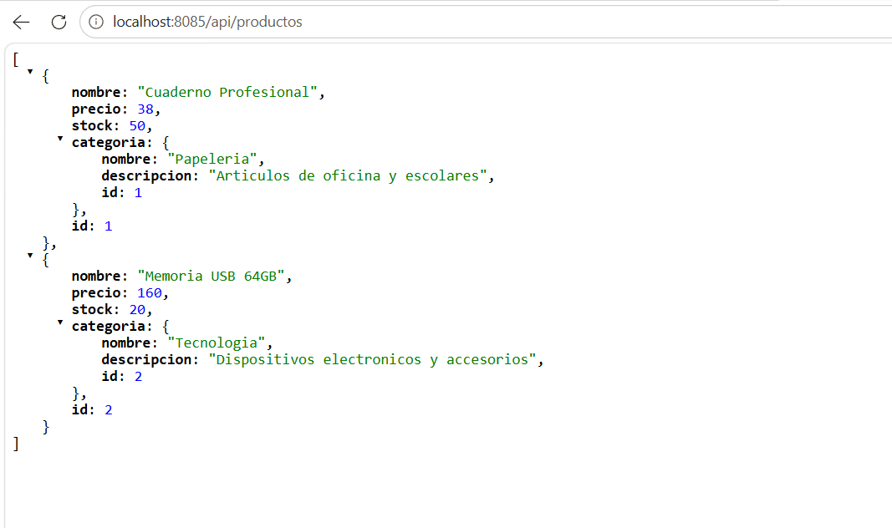
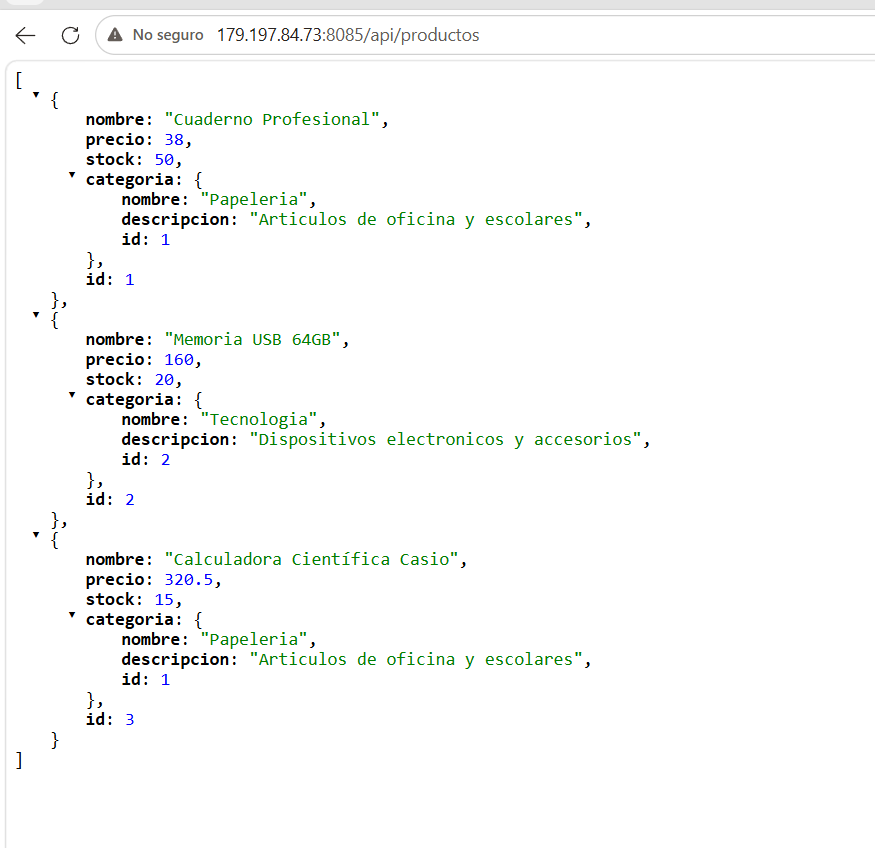
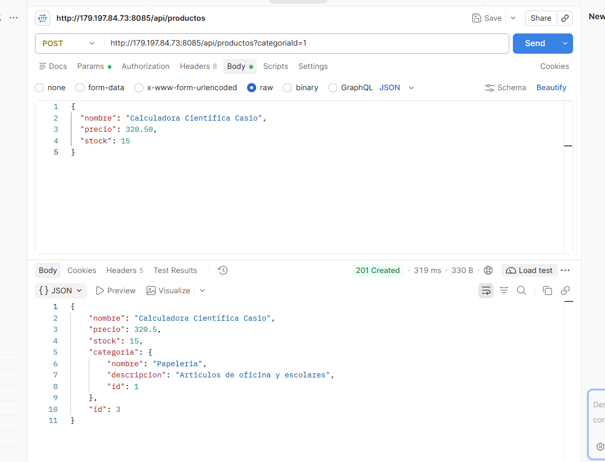

# Actividad 3 - Tema 4: CRUD con Spring Boot, JPA y Base de Datos Relacional MySQL

Proyecto backend desarrollado con Spring Boot y Spring Data JPA que implementa un CRUD completo persistido en un servidor MySQL real, estableciendo una relación `@OneToMany` / `@ManyToOne` entre dos entidades del modelo de negocio (`Categoria` y `Producto`), desplegado de forma concurrente en un servidor VPS.

---

## 1. Tecnologías y Herramientas

- **Lenguaje:** Java 21
- **Framework:** Spring Boot (Spring Web, Spring Data JPA, DevTools)
- **ORM / Persistencia:** Hibernate  JPA
- **Motor de Base de Datos:** MySQL Server  8.x
- **Gestor de Dependencias:** Apache Maven
- **Cliente HTTP para Pruebas:** Postman 
- **Entorno de Despliegue:** VPS Ubuntu Linux (ejecutado con `nohup` en puerto 8085)

---

## 2. Modelo de Datos y Relación entre Entidades

Se implementaron dos entidades principales con una relación bidireccional:
- **`Categoria` (`@OneToMany`):** Entidad que agrupa bienes por clasificación (ej. Papelería, Tecnología). Contiene una colección de productos asociada.
- **`Producto` (`@ManyToOne`):** Entidad dependiente que contiene nombre, precio, stock y mantiene la llave foránea `categoria_id` (`@JoinColumn`) que la vincula forzosamente a una categoría.

## 3. Capturas de pantalla 

### Proyecto de manera local:

### Proyecto en la VPS:

### Consulata en postman:

## 4. URLs de las consultas 

### De manera local 
#### Productos de manera local:
`http://localhost:8085/api/productos`

#### Categorias de manera local:
`http://localhost:8085/api/categorias`

`http://localhost:8085/api/productos/3`

### En la VPS:

`http://179.197.84.73:8085/api/productos`

`http://179.197.84.73:8085/api/categorias`

### En postman:
#### Agregar un nuevo producto
`http://localhost:8085/api/productos?categoriaId=1`
